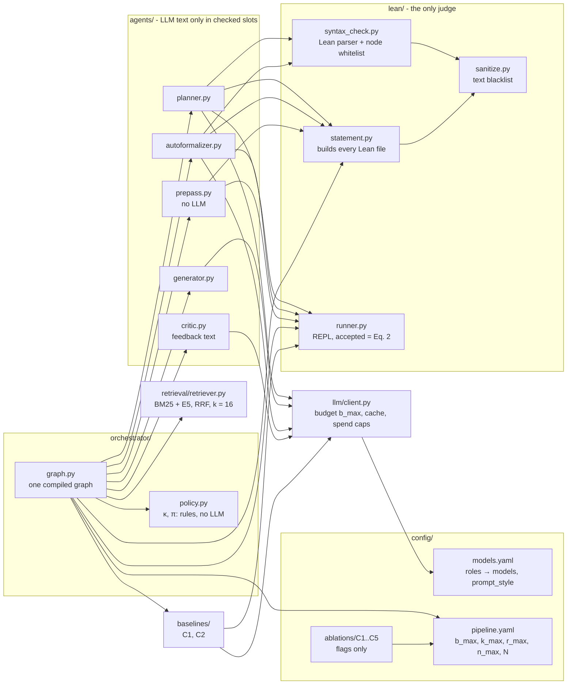
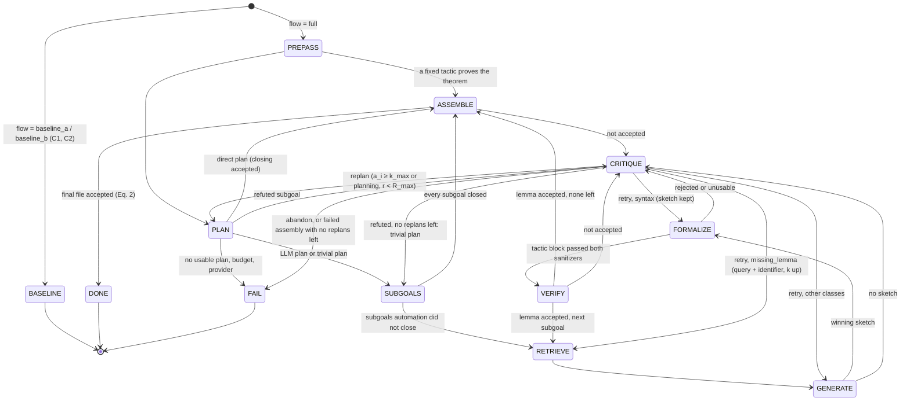
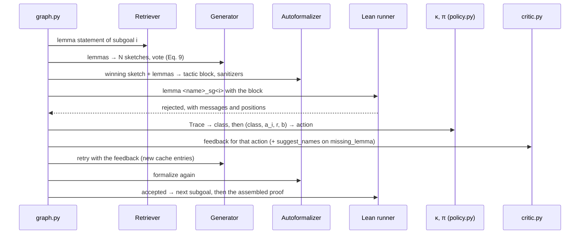

# Architecture

State after Phase 6: Retriever, Lean verifier, LLM client, Planner, Generator, Autoformalizer,
automation pre-pass, Critic (κ, π, feedback) and the LangGraph graph shared by C1–C5.

## 1. Components

Rules the components enforce (CLAUDE.md §1):

- Only `runner.accepted` decides correctness (compiles, no `sorry`, axioms ⊆ {propext,
  Classical.choice, Quot.sound}, no extra declarations). No LLM output is a verdict.
- Models only fill three slots: subgoal propositions, the closing block, tactic blocks.
  `statement.py` writes every theorem, lemma, skeleton and assembled file.
- Every generated text passes `sanitize.py` and then `syntax_check.py` before Lean
  compiles it. Fixed tactic lists from `pipeline.yaml` pass `sanitize.py` too.
- Lean must really have Mathlib loaded: after the import the REPL answers `#check @<probe>`
  (`pipeline.yaml → lean.probes`) at start and at every restart; on failure it is restarted
  once, then the file back-end runs the same probes. `run_eval.py` calls
  `runner.ensure_available()` before the first problem and after each one; if neither
  back-end loads, the run stops with status `lean_unavailable` (exit code 2) before any
  further LLM call, and the last problem's row is marked `lean_down`.
- `run_eval.py` copies its console to `runs/<run>/console.log`.
- C2 never verifies itself (`solved` is None). `run_baseline_b.py --check` (= `run_eval.py --config C2
  --check`) measures FPR_B (Eq. 16): each claimed proof is the Autoformalizer's sketch on the trivial
  plan, up to `critic.k_max` attempts with κ and the Critic's deterministic feedback, Retriever lemmas as
  in C5, no pre-pass, its own `B_max` budget; only `accepted` on the assembled theorem counts
  (`baselines/baseline_b.check_claim`).
- Every LLM call goes through `llm/client.py` and counts for the problem's `b_max`.
- κ and π are pure functions; the Critic's optional LLM advice runs after π has decided.

## 2. State graph

Inside PLAN (Phase 4): the skeleton with `sorry` must compile; the refutation check rejects
plans whose subgoals Lean refutes from the theorem's hypotheses; the closing step alone must
be accepted, or a fixed automatic tactic replaces it (`closing_auto`); otherwise the trivial
plan (the goal as the only subgoal).

**Termination (Proposition 1).** Every CRITIQUE increments `a_i` or `r`, or ends, and a replan
resets `a_i` while `r` is bounded by `R_max`; the forward path visits each subgoal once per plan.
Calls: `C ≤ min{B_max, (R_max + 1)(b_P + n_max · k_max · (N + 2))}` = min{40, 92} = 40 with the
report's values. JSON repair calls count for `b` but are not in the structural term, so with them
only `B_max` bounds the calls. The graph's `recursion_limit` is above any reachable length.

## 3. Sequence of one attempt with a retry

## 4. Outputs

Each run writes `runs/<UTC time>_<config>_<profile>/`: `run_config.json` (models, seed,
Lean and Mathlib versions, the merged configuration and `flow`), `trace.jsonl` (one event per
line: LLM calls, `prepass`, `plan_*`, `retrieve`, `sketch_vote`, `formalize_*`, `critique`,
`subgoal_solved` with `solved_by`, `assemble`, `pipeline_end`) and `results.jsonl` (one line per
problem, with `status`, `solved`, `stage`, `error_classes`, `critiques`, `replans` and the accepted
`proof`).
