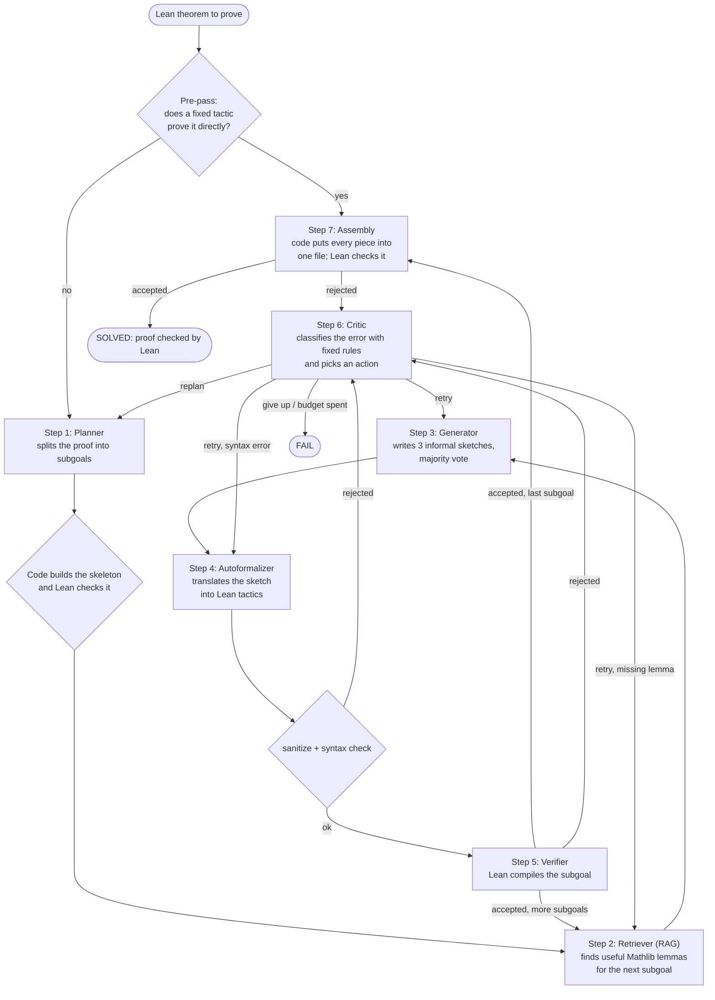

# How formal-mas works

This page is for readers who can program but have never used Lean and do not know this
project. It explains what the system does, why it needs Lean, and walks through one real run.
Terms in *italics* are explained in the [glossary](#glossary) at the end.

## 1. The problem, and why Lean is needed

The system receives an olympiad-style mathematics problem (for example from the AMC, the IMO
or the Putnam competition) and tries to produce a **proof**: not just an answer, but a
complete argument that the answer is right.

Large language models (LLMs) are good at writing text that *looks* like a proof. They are
also able to be confidently wrong: a step that skips a case, a computation that is off by one,
a lemma that does not exist. A human grader has to read every line to catch that, and even then
may miss it.

So the system does not ask anyone, human or model, whether a proof is right. It writes the
proof in **Lean 4**, a programming language in which mathematical statements are types and
proofs are programs. If the Lean *kernel* accepts the proof, the proof is correct, in the same
sense that a type checker guarantees a program has no type errors. If a single step is wrong,
Lean rejects the file. A false proof cannot pass.

In this project a problem counts as **solved** only when all three hold:

1. the final Lean file compiles;
2. it contains no `sorry` (Lean's placeholder for "I'll prove this later");
3. `#print axioms` lists only the three standard axioms (`propext`, `Classical.choice`,
   `Quot.sound`), so nothing was assumed without proof.

No LLM ever takes part in that decision.

## 2. The flow, step by step

Each problem comes with its statement already written in Lean (a *theorem* with its
hypotheses and conclusion, taken from public benchmarks). The system has to fill in the proof.



In words:

0. **Pre-pass.** Some problems fall to a single standard tactic (`linarith`, `norm_num`,
   `nlinarith`, …). The system tries a fixed list first, with no LLM call.
1. **Plan.** The Planner proposes intermediate facts (*subgoals*) that would make the proof
   easy, for example "first show `r ^ 2 = 3`". The code turns them into a Lean *skeleton*:
   the theorem with each subgoal stated and left as `sorry`. Lean checks that the skeleton is
   well formed, that no subgoal is obviously false, and that the subgoals really imply the
   theorem.
2. **Retrieve lemmas (RAG).** For each subgoal, the Retriever searches about 213,000
   declarations from *Mathlib* and returns the 16 most relevant ones, so the models can use
   real lemma names instead of inventing them.
3. **Sketch.** The Generator writes three informal proof sketches of the subgoal and the most
   common strategy wins (*self-consistency*).
4. **Translate to Lean.** The Autoformalizer turns the winning sketch into Lean tactics.
5. **Verify.** The tactics are checked by two filters (below), then Lean compiles the subgoal
   as a small lemma.
6. **Critic.** If anything fails, the Critic reads Lean's error, puts it in one of a few
   classes (syntax error, missing lemma, tactic failure, …) and applies a fixed policy:
   *retry* the step, *replan* the whole proof, or *give up*.
7. **Assemble.** When every subgoal is proved, the code writes the final file (the original
   theorem, each subgoal proved inline, and the planner's closing step) and Lean checks it
   once more against the three conditions of Section 1.

Every LLM call counts against a hard budget (`b_max` = 40 calls per problem for the full
system). Because the Critic's decisions are rules and every retry or replan uses up a
bounded counter, a run always ends.

## 3. What each agent does

| Agent | Uses an LLM? | What it does |
|---|---|---|
| **Pre-pass** | no | Tries a fixed list of standard tactics on the whole theorem. |
| **Planner** | yes | Proposes up to a few subgoals and a closing step. It only writes the *propositions*; the code writes the Lean file around them. |
| **Retriever** | no (search index) | Finds the Mathlib lemmas most related to a subgoal, using keyword search (BM25) and embedding similarity, merged into one ranking. |
| **Generator** | yes | Writes 3 independent informal sketches of how to prove a subgoal; a majority vote picks the strategy. |
| **Autoformalizer** | yes | Translates the chosen sketch into a block of Lean tactics. |
| **Verifier** | no | Runs Lean. It is the only component that decides whether something is proved. |
| **Critic** | rules (+ optional LLM advice) | Classifies each failure and chooses retry / replan / give up by fixed rules. In the full system it may also ask an LLM for a short hint for the next attempt, but the hint never changes the decision. |

## 4. Why the LLM never writes the statement, and what `sanitize` protects

**The statement is off limits.** If a model could edit the theorem, the easiest way to "prove"
a hard problem would be to quietly weaken it: drop a condition, change `≤` to `<`, or prove
something unrelated that happens to compile. So the models only ever fill three kinds of
slots: a subgoal proposition, a tactic block, and the closing step. The code
(`src/formal_mas/lean/statement.py`) writes every theorem header, every lemma and the final
file. The theorem that Lean checks at the end is, character for character, the one in the
dataset.

**Sanitize** (`src/formal_mas/lean/sanitize.py`) is a filter that reads every piece of
generated text *before* Lean sees it, and rejects anything that could escape its slot or cheat:

- `sorry`, `admit` and similar "skip this proof" commands;
- new top-level commands (`theorem`, `axiom`, `def`, …) hidden inside a tactic block, or a
  line indented so that it closes the proof early and starts something else;
- options or metaprogramming that could switch off checks, and `native_decide`, which adds an
  extra axiom;
- anything that could run programs (`IO`), and leftover Lean 3 syntax.

A second filter (`syntax_check.py`) parses the text with Lean's own parser and accepts only a
whitelist of syntax kinds. Neither filter decides correctness; they only make sure that what
reaches Lean is an honest attempt at the requested step. If a filter rejects the text, the
Critic gets the reason and the agent tries again.

## 5. A real example from start to finish

Problem `amc12_2001_p9` (algebra, medium), solved by the full system (C5) on the `test` split.
Source: `runs/20261103T174646Z_C5_experiment/` (`results.jsonl` and `trace.jsonl`).

**The problem.** Let *f* satisfy *f(xy) = f(x)/y* for all positive reals *x, y*. If
*f(500) = 3*, what is *f(600)*? (Answer: 5/2.)

**The statement in Lean** (fixed by the dataset; no model touches it):

```lean
theorem amc12_2001_p9 (f : ℝ → ℝ) (h₀ : ∀ x > 0, ∀ y > 0, f (x * y) = f x / y) (h₁ : f 500 = 3) :
    f 600 = 5 / 2
```

**Step 0, pre-pass.** None of the fixed tactics proves it directly.

**Step 1, plan** (1 LLM call). The Planner proposes one subgoal and a closing step:

- subgoal `h1`: `f 600 = f 500 / (6 / 5)`
- closing: `rw [h1, h₁]` then `norm_num` (replace *f(600)*, then *f(500)*, then compute 3 ÷ 6/5)
- rationale: "Use the functional equation with x = 500 and y = 6/5, since 500 · (6/5) = 600."

The code builds the skeleton with `h1` left as `sorry`. Lean confirms that it compiles, that
the subgoal is not refutable, and that the closing step really finishes the theorem once `h1`
is given.

**Step 2, retrieve.** The Retriever returns 16 Mathlib lemmas for the subgoal (e.g.
`Real.div_rpow`, `Real.rpow_sub'`). Here they are not useful: the subgoal needs only the
problem's own hypothesis. The search does not always help, which is why configuration C3
measures the system without it.

**Step 3, sketch** (3 LLM calls). The three sketches agree on the idea; the vote is
`direct_computation` 2, `algebraic_manipulation` 1. The winning sketch:

> 1. Since 500 > 0 and 6/5 > 0, apply h₀ with x = 500 and y = 6/5: f(500 · 6/5) = f(500)/(6/5).
> 2. Compute 500 · 6/5 = 600, so f(600) = f(500)/(6/5).

**Step 4, translate (attempt 1)** (1 LLM call). The Autoformalizer returns:

```lean
have h := h₀ 500 (by norm_num) (6 / 5) (by norm_num)
 norm_num at h ⊢
 exact h
```

**Rejected before compiling.** The last two lines are indented by one extra space, so Lean's
parser reads them as part of the first line (`expected end of input`). The syntax filter stops
it (`sanitize:parse`).

**Step 6, Critic.** The fixed rules classify the failure as `syntax` and choose **retry**, going back
to the Autoformalizer with the same sketch. The optional LLM hint (1 call) guessed the wrong
cause (it blamed Unicode in the name); it did not matter, because the hint never changes the
action and Lean's error message is passed along too.

**Step 4, translate (attempt 2)** (1 LLM call):

```lean
have h := h₀ 500 (by norm_num) (6 / 5) (by norm_num)
have h' : (500 : ℝ) * (6 / 5) = 600 := by norm_num
rw [h'] at h
exact h
```

**Step 5, verify.** Both filters pass it; Lean compiles the subgoal lemma
`amc12_2001_p9_sg1`. Accepted.

**Step 7, assemble.** The code writes the final file and Lean checks it (compiles, no
`sorry`, standard axioms only; the `import Mathlib` header lines are omitted here):

```lean
theorem amc12_2001_p9 (f : ℝ → ℝ) (h₀ : ∀ x > 0, ∀ y > 0, f (x * y) = f x / y) (h₁ : f 500 = 3) :
    f 600 = 5 / 2 := by
  have h1 : f 600 = f 500 / (6 / 5) := by
    have h := h₀ 500 (by norm_num) (6 / 5) (by norm_num)
    have h' : (500 : ℝ) * (6 / 5) = 600 := by norm_num
    rw [h'] at h
    exact h
  rw [h1, h₁]
  norm_num
```

**Total:** 7 LLM calls (1 plan + 3 sketches + 2 translations + 1 hint) out of a budget of 40,
about 0.003 USD, 23 seconds.

## 6. The five configurations

The same graph runs in five ways (C1–C5), changing only flags in `config/ablations/`. They
are described in [results_explained.md](results_explained.md).

## Glossary

- **Lean (Lean 4).** A programming language and proof assistant. A theorem is a type; a proof
  is a program of that type; compiling the file checks the proof.
- **Kernel.** The small core of Lean that checks every proof. Everything else (tactics,
  automation) only produces proofs that the kernel then re-checks, so bugs elsewhere cannot
  make a false proof pass.
- **Mathlib.** Lean's community mathematics library, with hundreds of thousands of definitions
  and lemmas. Our proofs may use any of them.
- **Lemma.** A proved statement that can be reused, like a library function.
- **Tactic.** A command that builds part of a proof (e.g. `linarith` solves linear
  inequalities, `norm_num` does arithmetic, `rw` rewrites with an equation).
- **`sorry`.** A placeholder that tells Lean "assume this is proved". Useful for skeletons;
  any final proof containing it is rejected.
- **Axioms.** Facts accepted without proof. Lean's standard mathematics uses three; a proof
  that depends on any other is rejected.
- **Subgoal.** An intermediate fact the Planner asks the system to prove first.
- **Skeleton.** The theorem with its subgoals stated and their proofs left as `sorry`; used to
  check a plan before trying to prove each step.
- **RAG (retrieval-augmented generation).** Searching a collection (here, Mathlib) and putting
  the most relevant results in the model's prompt.
- **Self-consistency.** Asking for several independent answers and keeping the most common one.
- **Autoformalization.** Translating informal mathematics into a formal language like Lean.
- **Budget (`b_max`).** The maximum number of LLM calls allowed for one problem.
- **κ and π.** The Critic's error classifier and decision policy; both are fixed rules, not models.
