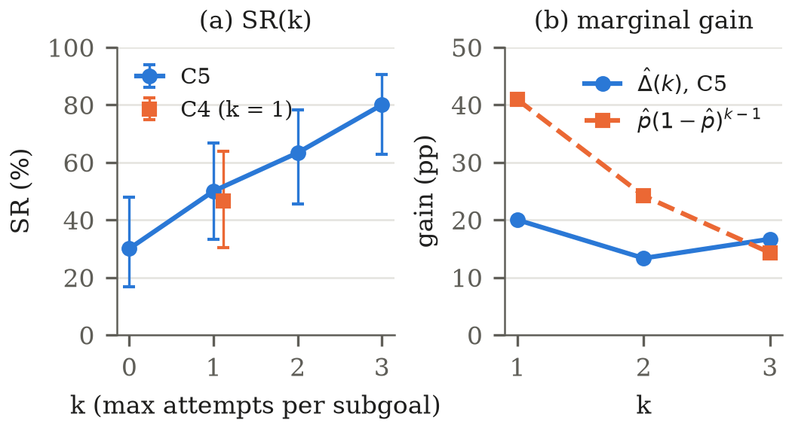

# What was tested and what came out

The single, complete results document of the project: dataset, configurations, every table of
the analysis, the SR(k) figure, the deviations from the analysis plan, the fidelity review, the
limitations, and a guide to what goes in each section of the report. It is written so that the
report can be drafted from this file alone. For how the system works, see
[how_it_works.md](how_it_works.md). The pre-registered analysis plan is
[analysis_plan.md](analysis_plan.md) (written before any `test` result was seen); the full
statistical tables are in `docs/results/`.

**Where the numbers come from.** Every table below is copied verbatim from
`docs/results/results.md`, which `docs/results/make_tables.py` generates from `runs/`
(read-only). Nothing here is recomputed. `results.md` stays the generated source; this file is the
version to read. After `make_tables.py` is re-run, `python docs/results/check_explained.py`
checks that every table and every number here still matches `results.md`. The LaTeX version of
each table is in `docs/results/tables.tex`, under the label given with each table.

**Status labels used below.**

- **Planned (confirmatory)**: a test fixed in `analysis_plan.md` before `test` was run; the only
  results that support claims.
- **Planned (exploratory)**: listed in the plan as exploratory: uncorrected, no claims.
- **Planned (descriptive)**: required by the plan, without tests.
- **Supplementary**: requested by the team after the plan, descriptive only.
- **Post hoc**: a look decided after seeing the results; descriptive only, not in the plan.
- **Integrity check**: describes the data, not the method.

Rates are in %, intervals are 95 %.

## 1. The dataset

`data/eval.jsonl` holds **45 problems**, each with its informal text and its Lean statement:

| | easy | medium | hard | total |
|---|---|---|---|---|
| `dev` (for tuning) | 5 | 5 | 5 | 15 |
| `test` (final runs only) | 10 | 10 | 10 | 30 |

- **Sources:** 40 from miniF2F (the Lean 4 port used by DeepSeek-Prover-V1.5) and 5 from
  PutnamBench (3 of them in `test`).
- **Areas in `test`:** algebra 13, number theory 13, combinatorics 4 (no easy combinatorics
  problem: that cell of the 3 × 3 grid is empty).
- Every statement was checked to compile and reviewed by hand for fidelity to the informal
  text (`data/curation/`; see §10). Prompts and settings were tuned only on `dev`; `test` was
  used once, for the final runs.

## 2. The five configurations

All five run on the same code and graph; only flags in `config/ablations/` change.

| | Name | In one line |
|---|---|---|
| **C1** | Baseline A | One LLM asked directly for a whole Lean proof; up to 18 independent tries (Lean's errors are not fed back). No agents. |
| **C2** | Baseline B | One LLM solves the problem in natural language and judges its own answer. No Lean. |
| **C3** | No RAG | Full system without the lemma search. |
| **C4** | No Critic | Full system, but one attempt per subgoal and no replanning. |
| **C5** | Full system | All agents, retries and replanning, up to 40 calls per problem. |

All runs used the same model for every role (DeepSeek `deepseek-flash`, a general-purpose
model, not a specialised prover), the same seed (2026), Lean `v4.36.0-rc1` and Mathlib
`625d891`. The exact settings of each run are in its `runs/<run>/run_config.json`.

## 3. Runs and data integrity

### 3.1 Runs used

*Integrity check · LaTeX `tab:runs`.* Which run folders feed the analysis and their recorded
configuration. C5 and C1 were interrupted and resumed (§11), so each has more than one folder;
their pieces are merged into one row per problem. "running" means the run was killed before it
could write its final status; "dirty (plan file only)" is a recording artefact explained in §11.

| Run | Config | Profile | Seed | Split | Commit | Tree | Degraded | Run status | vs first run |
|---|---|---|---|---|---|---|---|---|---|
| 20261103T174646Z_C5_experiment | C5 | experiment | 2026 | test | ad70ec2 | clean | False | running | same |
| 20261103T212359Z_C5_experiment_resume | C5 | experiment | 2026 | test | ad70ec2 | dirty (plan file only) | False | budget_stop | same |
| 20261103T225140Z_C5_experiment_resume2 | C5 | experiment | 2026 | test | 93bc701 | dirty (plan file only) | False | finished | same |
| 20261103T235556Z_C4_experiment | C4 | experiment | 2026 | test | ea4db4b | dirty (plan file only) | False | finished | same |
| 20261104T194056Z_C3_experiment | C3 | experiment | 2026 | test | 6c61d69 | clean | False | finished | same |
| 20261104T232056Z_C2_experiment_check | C2 | experiment | 2026 | test | 6c61d69 | clean | False | finished | same |
| 20261105T131443Z_C1_experiment | C1 | experiment | 2026 | test | 5ed7507 | clean | False | running | same |
| 20261107T200233Z_C1_experiment_resume | C1 | experiment | 2026 | test | 2c8eae5 | dirty (plan file only) | False | finished | same |

### 3.2 Row checks

*Integrity check · LaTeX `tab:checks`.* After merging, every configuration has exactly 30 rows
(one per `test` problem), and every row's split, configuration, area and difficulty match the
dataset.

| Config | Rows | Status counts | lean_down | split/config mismatch | area/difficulty mismatch |
|---|---|---|---|---|---|
| C1 | 30 | budget_exhausted: 7, failed: 3, solved: 20 | 0 | 0 | 0 |
| C2 | 30 | claimed_solved: 30 | 0 | 0 | 0 |
| C3 | 30 | budget_exhausted: 3, failed: 7, solved: 20 | 0 | 0 | 0 |
| C4 | 30 | failed: 16, solved: 14 | 0 | 0 | 0 |
| C5 | 30 | failed: 6, solved: 24 | 0 | 0 | 0 |

### 3.3 Infrastructure and error statuses

*Planned (plan §5 and §7 item 7) · LaTeX `tab:infra`.* No row ended because of the provider,
the spend cap, a bug, or Lean being unavailable, so the plan's re-run rule and sensitivity
analysis were never needed. Every failure in this document is a failure of the method itself.

| Config | provider_error | budget_stop | error | node_error | invalid_statement | lean_down |
|---|---|---|---|---|---|---|
| C1 | 0 | 0 | 0 | 0 | 0 | 0 |
| C2 | 0 | 0 | 0 | 0 | 0 | 0 |
| C3 | 0 | 0 | 0 | 0 | 0 | 0 |
| C4 | 0 | 0 | 0 | 0 | 0 | 0 |
| C5 | 0 | 0 | 0 | 0 | 0 | 0 |

## 4. Main result: verified success

### 4.1 Success rate (SR)

*Planned (primary outcome, plan §2 and §7 item 1) · LaTeX `tab:sr`.* A problem counts as solved
only if Lean's kernel accepts the final proof. The full system C5 solved 24/30; C1 and C3 20/30;
C4 14/30. C2 never uses Lean, so it has no SR: it appears through how often it claimed success
and how often that claim could not be confirmed (FPR_B, §6). The intervals are wide and overlap:
that is what 30 problems allow.

| Config | Solved | SR (%) | Wilson 95 % CI (%) | C2 claimed rate (%) [Wilson] | FPR_B (%) [Wilson] |
|---|---|---|---|---|---|
| C1 | 20/30 | 66.7 | [48.8, 80.8] | — | — |
| C3 | 20/30 | 66.7 | [48.8, 80.8] | — | — |
| C4 | 14/30 | 46.7 | [30.2, 63.9] | — | — |
| C5 | 24/30 | 80.0 | [62.7, 90.5] | — | — |
| C2 (Baseline B) | — | — | — | 30/30 = 100.0 [88.6, 100.0] | 11/30 = 36.7 [21.9, 54.5] |

*Note.* C2 is not verified, so it has no SR; it enters only through its claimed rate B⁺/n and FPR_B (plan §7.1). Of the 30 claimed proofs the formal check verified 19 and did not verify 11; 0 left out of FPR_B.

### 4.2 The three planned comparisons (H1–H3)

*Planned (confirmatory, plan §3) · LaTeX `tab:mcnemar`.* Exact McNemar test on the same 30
problems, Bonferroni correction for 3 tests (a comparison is significant only if its adjusted p
is below 0.05). *b* = problems only C5 solved, *c* = problems only the other configuration
solved. ΔSR is the difference in success rate in percentage points, with a paired bootstrap
interval.

| ID | Comparison | b | c | ΔSR (pp) | Paired bootstrap 95 % CI (pp) | Exact p | Bonferroni p | Reject at 0.05/3 |
|---|---|---|---|---|---|---|---|---|
| H1 | C5 vs C1 | 4 | 0 | +13.3 | [+3.3, +26.7] | 0.1250 | 0.3750 | no |
| H2 | C5 vs C3 | 5 | 1 | +13.3 | [+0.0, +30.0] | 0.2188 | 0.6562 | no |
| H3 | C5 vs C4 | 10 | 0 | +33.3 | [+16.7, +50.0] | 0.0020 | 0.0059 | yes |

*Note.* n = 30, so power is low: a non-significant result is no evidence of a difference, not evidence of no difference. H2 is Δ_RAG = SR_C5 − SR_C3; H3 is the Critic contribution SR_C5 − SR_C4.

In plain words:

- **H3: the Critic (retry and replan) makes a significant difference.** C5 solved 10 problems
  that C4 did not, and C4 solved none that C5 missed (+33.3 pp, paired bootstrap interval
  [+16.7, +50.0], Bonferroni p 0.0059).
- **H1 and H2 point in C5's favour but are not significant.** C5 vs C1: 4 problems to 0;
  C5 vs C3: 5 to 1; both +13.3 pp. With 30 problems a difference of 4 or 5 problems is
  compatible with chance. "Not significant" here means *no evidence of a difference*, not
  evidence that there is none: the test has little power at this sample size.

### 4.3 Exploratory comparisons

*Planned (exploratory, plan §3): uncorrected, no claims · LaTeX `tab:mcnemar-expl`.* The other
pairs of verified configurations. C1 and C3 solve the same number of problems but not the same
problems (3 each way).

| ID | Comparison | b | c | ΔSR (pp) | Exact p (uncorrected) |
|---|---|---|---|---|---|
| E1 | C3 vs C4 | 9 | 3 | +20.0 | 0.1460 |
| E2 | C1 vs C3 | 3 | 3 | +0.0 | 1.0000 |
| E3 | C1 vs C4 | 8 | 2 | +20.0 | 0.1094 |

## 5. Results by difficulty and area

### 5.1 Solved per cell of the 3 × 3 grid

*Planned (descriptive, plan §4.1) · LaTeX `tab:cells`.* How many problems each configuration
solved in each (difficulty, area) cell. Cells have at most 5 problems, so there are no tests
and no intervals. For C2 the column counts *claimed* solutions, not verified ones.

| Difficulty | Area | n | C1 | C3 | C4 | C5 | C2 (claimed) |
|---|---|---|---|---|---|---|---|
| easy | Algebra | 5 | 5/5 | 5/5 | 4/5 | 5/5 | 5/5 |
| easy | Number theory | 5 | 5/5 | 4/5 | 5/5 | 5/5 | 5/5 |
| easy | Combinatorics | 0 | — | — | — | — | — |
| medium | Algebra | 5 | 4/5 | 5/5 | 1/5 | 5/5 | 5/5 |
| medium | Number theory | 4 | 2/4 | 2/4 | 2/4 | 4/4 | 4/4 |
| medium | Combinatorics | 1 | 0/1 | 0/1 | 1/1 | 1/1 | 1/1 |
| hard | Algebra | 3 | 1/3 | 2/3 | 0/3 | 1/3 | 3/3 |
| hard | Number theory | 4 | 1/4 | 1/4 | 0/4 | 1/4 | 4/4 |
| hard | Combinatorics | 3 | 2/3 | 1/3 | 1/3 | 2/3 | 3/3 |

### 5.2 Success rate by difficulty and by area

*Planned (descriptive, plan §4.1) · LaTeX `tab:margins` (wide table).* The margins of the grid:
first line solved/n, second line SR % with its Wilson interval. Every verified configuration
solves almost all easy problems and 4/10 or fewer hard ones; C5's advantage is on medium
problems (10/10). C2 claims every problem, at every difficulty.

| Config | easy (n = 10) | medium (n = 10) | hard (n = 10) | Algebra (n = 13) | Number theory (n = 13) | Combinatorics (n = 4) |
|---|---|---|---|---|---|---|
| C1 | 10/10 | 6/10 | 4/10 | 10/13 | 8/13 | 2/4 |
|  | 100.0 [72.2, 100.0] | 60.0 [31.3, 83.2] | 40.0 [16.8, 68.7] | 76.9 [49.7, 91.8] | 61.5 [35.5, 82.3] | 50.0 [15.0, 85.0] |
| C3 | 9/10 | 7/10 | 4/10 | 12/13 | 7/13 | 1/4 |
|  | 90.0 [59.6, 98.2] | 70.0 [39.7, 89.2] | 40.0 [16.8, 68.7] | 92.3 [66.7, 98.6] | 53.8 [29.1, 76.8] | 25.0 [4.6, 69.9] |
| C4 | 9/10 | 4/10 | 1/10 | 5/13 | 7/13 | 2/4 |
|  | 90.0 [59.6, 98.2] | 40.0 [16.8, 68.7] | 10.0 [1.8, 40.4] | 38.5 [17.7, 64.5] | 53.8 [29.1, 76.8] | 50.0 [15.0, 85.0] |
| C5 | 10/10 | 10/10 | 4/10 | 11/13 | 10/13 | 3/4 |
|  | 100.0 [72.2, 100.0] | 100.0 [72.2, 100.0] | 40.0 [16.8, 68.7] | 84.6 [57.8, 95.7] | 76.9 [49.7, 91.8] | 75.0 [30.1, 95.4] |
| C2 (claimed) | 10/10 | 10/10 | 10/10 | 13/13 | 13/13 | 4/4 |
|  | 100.0 [72.2, 100.0] | 100.0 [72.2, 100.0] | 100.0 [72.2, 100.0] | 100.0 [77.2, 100.0] | 100.0 [77.2, 100.0] | 100.0 [51.0, 100.0] |

### 5.3 The 10 hard problems

*Post hoc (not in the analysis plan), descriptive · LaTeX `tab:hard`.* One row per hard problem,
1 = verified solved.

| Problem | Area | C1 | C3 | C4 | C5 | Solved by |
|---|---|---|---|---|---|---|
| imo_1964_p1_2 | Number theory | 1 | 1 | 0 | 1 | 3 |
| imo_1965_p2 | Algebra | 1 | 1 | 0 | 1 | 3 |
| imo_1978_p5 | Algebra | 0 | 0 | 0 | 0 | 0 |
| imo_1979_p1 | Number theory | 0 | 0 | 0 | 0 | 0 |
| imo_1984_p6 | Number theory | 0 | 0 | 0 | 0 | 0 |
| imo_1987_p6 | Number theory | 0 | 0 | 0 | 0 | 0 |
| imo_1993_p5 | Algebra | 0 | 1 | 0 | 0 | 1 |
| putnam_1964_b2 | Combinatorics | 1 | 0 | 1 | 1 | 3 |
| putnam_1965_b2 | Combinatorics | 1 | 1 | 0 | 1 | 3 |
| putnam_1995_b1 | Combinatorics | 0 | 0 | 0 | 0 | 0 |
| Solved |  | 4/10 | 4/10 | 1/10 | 4/10 |  |

*Note.* Post hoc, descriptive (not in the analysis plan): no tests, no intervals. 1 = verified solved. C1 and C5 solve the same hard problems (4 and 4); 5 hard problems are solved by no configuration (imo_1978_p5, imo_1979_p1, imo_1984_p6, imo_1987_p6, putnam_1995_b1); C3 and C5 solve 4 and 4 hard problems, but only C3 solves imo_1993_p5 and only C5 solves putnam_1964_b2.

Three things stand out. C1 and C5 solve exactly the same 4 hard problems (imo_1964_p1_2,
imo_1965_p2, putnam_1964_b2, putnam_1965_b2), so on the hard tier the whole C5 gain over C1
disappears: all 4 problems that C5 solves and C1 does not are medium (§5.5). Five hard problems
(imo_1978_p5, imo_1979_p1, imo_1984_p6, imo_1987_p6, putnam_1995_b1) are solved by no
configuration. C3 and C5 also solve 4 each but differ by one problem in each direction: only
C3 solves imo_1993_p5, only C5 solves putnam_1964_b2. Since C5 has everything C3 has plus
retrieval, a hard problem that C3 solves and C5 does not shows how much a single run can vary
from one to the next; each configuration was run once, so differences of one problem should
not be read as an effect.

### 5.4 Per-problem outcomes

*Data listing (the source of the counts above) · LaTeX `tab:per-problem` (wide table).* One row
per `test` problem: 1 = verified solved; the last column gives C2's claim and whether the Lean
check confirmed it.

| Problem | Difficulty | Area | C1 | C3 | C4 | C5 | C2 (claim, check) |
|---|---|---|---|---|---|---|---|
| algebra_absapbon1pabsapbleqsumabsaon1pabsa | medium | Algebra | 0 | 1 | 0 | 1 | claimed, verified |
| amc12_2000_p20 | medium | Algebra | 1 | 1 | 0 | 1 | claimed, verified |
| amc12_2001_p9 | medium | Algebra | 1 | 1 | 0 | 1 | claimed, verified |
| amc12a_2008_p15 | medium | Number theory | 0 | 0 | 0 | 1 | claimed, not_verified |
| amc12a_2008_p25 | medium | Algebra | 1 | 1 | 0 | 1 | claimed, verified |
| amc12b_2002_p3 | medium | Number theory | 0 | 1 | 1 | 1 | claimed, not_verified |
| amc12b_2003_p6 | medium | Algebra | 1 | 1 | 1 | 1 | claimed, verified |
| imo_1964_p1_2 | hard | Number theory | 1 | 1 | 0 | 1 | claimed, not_verified |
| imo_1965_p2 | hard | Algebra | 1 | 1 | 0 | 1 | claimed, not_verified |
| imo_1978_p5 | hard | Algebra | 0 | 0 | 0 | 0 | claimed, not_verified |
| imo_1979_p1 | hard | Number theory | 0 | 0 | 0 | 0 | claimed, not_verified |
| imo_1984_p6 | hard | Number theory | 0 | 0 | 0 | 0 | claimed, not_verified |
| imo_1987_p6 | hard | Number theory | 0 | 0 | 0 | 0 | claimed, not_verified |
| imo_1993_p5 | hard | Algebra | 0 | 1 | 0 | 0 | claimed, not_verified |
| mathd_algebra_160 | easy | Algebra | 1 | 1 | 1 | 1 | claimed, verified |
| mathd_algebra_206 | easy | Algebra | 1 | 1 | 0 | 1 | claimed, verified |
| mathd_algebra_234 | easy | Algebra | 1 | 1 | 1 | 1 | claimed, verified |
| mathd_algebra_288 | easy | Algebra | 1 | 1 | 1 | 1 | claimed, verified |
| mathd_algebra_455 | easy | Algebra | 1 | 1 | 1 | 1 | claimed, verified |
| mathd_numbertheory_321 | easy | Number theory | 1 | 0 | 1 | 1 | claimed, verified |
| mathd_numbertheory_328 | easy | Number theory | 1 | 1 | 1 | 1 | claimed, verified |
| mathd_numbertheory_345 | easy | Number theory | 1 | 1 | 1 | 1 | claimed, verified |
| mathd_numbertheory_430 | easy | Number theory | 1 | 1 | 1 | 1 | claimed, verified |
| mathd_numbertheory_64 | easy | Number theory | 1 | 1 | 1 | 1 | claimed, verified |
| numbertheory_3pow2pownm1mod2pownp3eq2pownp2 | medium | Number theory | 1 | 0 | 0 | 1 | claimed, verified |
| numbertheory_notequiv2i2jasqbsqdiv8 | medium | Number theory | 1 | 1 | 1 | 1 | claimed, verified |
| numbertheory_sumkmulnckeqnmul2pownm1 | medium | Combinatorics | 0 | 0 | 1 | 1 | claimed, verified |
| putnam_1964_b2 | hard | Combinatorics | 1 | 0 | 1 | 1 | claimed, verified |
| putnam_1965_b2 | hard | Combinatorics | 1 | 1 | 0 | 1 | claimed, not_verified |
| putnam_1995_b1 | hard | Combinatorics | 0 | 0 | 0 | 0 | claimed, not_verified |

### 5.5 Problems solved by one configuration and not the other

*Descriptive (discordant pairs of the comparisons; candidates for example traces in the
report).* For each pair, the problems behind *b* and *c* of Tables 2 and 2b, with what C5 did on
them (status, LLM calls, replans, and the largest number of attempts on any subgoal of the
accepted plan).

- C5 solved, C4 not (Critic loop): algebra_absapbon1pabsapbleqsumabsaon1pabsa (C5: solved, 24 calls, replans 1, max attempts 1); amc12_2000_p20 (C5: solved, 23 calls, replans 0, max attempts 3); amc12_2001_p9 (C5: solved, 7 calls, replans 0, max attempts 2); amc12a_2008_p15 (C5: solved, 16 calls, replans 0, max attempts 3); amc12a_2008_p25 (C5: solved, 23 calls, replans 0, max attempts 2); imo_1964_p1_2 (C5: solved, 15 calls, replans 0, max attempts 3); imo_1965_p2 (C5: solved, 14 calls, replans 0, max attempts 2); mathd_algebra_206 (C5: solved, 28 calls, replans 0, max attempts 2); numbertheory_3pow2pownm1mod2pownp3eq2pownp2 (C5: solved, 15 calls, replans 0, max attempts 3); putnam_1965_b2 (C5: solved, 17 calls, replans 0, max attempts 3)
- C4 solved, C5 not: —
- C5 solved, C3 not (RAG): amc12a_2008_p15 (C5: solved, 16 calls, replans 0, max attempts 3); mathd_numbertheory_321 (C5: solved, 1 calls, replans 0, max attempts 0); numbertheory_3pow2pownm1mod2pownp3eq2pownp2 (C5: solved, 15 calls, replans 0, max attempts 3); numbertheory_sumkmulnckeqnmul2pownm1 (C5: solved, 5 calls, replans 0, max attempts 1); putnam_1964_b2 (C5: solved, 9 calls, replans 0, max attempts 1)
- C3 solved, C5 not: imo_1993_p5 (C5: failed, 27 calls, replans 1, max attempts -)
- C5 solved, C1 not: algebra_absapbon1pabsapbleqsumabsaon1pabsa (C5: solved, 24 calls, replans 1, max attempts 1); amc12a_2008_p15 (C5: solved, 16 calls, replans 0, max attempts 3); amc12b_2002_p3 (C5: solved, 9 calls, replans 0, max attempts 1); numbertheory_sumkmulnckeqnmul2pownm1 (C5: solved, 5 calls, replans 0, max attempts 1)
- C1 solved, C5 not: —
- C2 claimed, check did not verify: amc12a_2008_p15 (C5: solved, 16 calls, replans 0, max attempts 3); amc12b_2002_p3 (C5: solved, 9 calls, replans 0, max attempts 1); imo_1964_p1_2 (C5: solved, 15 calls, replans 0, max attempts 3); imo_1965_p2 (C5: solved, 14 calls, replans 0, max attempts 2); imo_1978_p5 (C5: failed, 31 calls, replans 1, max attempts -); imo_1979_p1 (C5: failed, 28 calls, replans 1, max attempts -); imo_1984_p6 (C5: failed, 32 calls, replans 1, max attempts -); imo_1987_p6 (C5: failed, 36 calls, replans 1, max attempts -); imo_1993_p5 (C5: failed, 27 calls, replans 1, max attempts -); putnam_1965_b2 (C5: solved, 17 calls, replans 0, max attempts 3); putnam_1995_b1 (C5: failed, 25 calls, replans 1, max attempts -)

## 6. Baseline B (C2): what the LLM claimed vs what Lean confirmed

*Planned (plan §4.2, Eq. 16) · LaTeX `tab:fprb`.* C2 never uses Lean, so it cannot "solve"
anything in the verified sense. Instead it reports whether it believes its own proof is
correct. To see how often that belief is wrong, each claimed proof was handed to the Lean
pipeline (Autoformalizer + Verifier, up to 3 attempts, same lemma search as C5;
`--check` in `scripts/run_baseline_b.py`).

| Quantity | Value |
|---|---|
| Problems | 30 |
| Claimed (B⁺) | 30 |
| Not claimed | 0 |
| Check status among B⁺ | not_verified: 11, verified: 19 |
| Verified (Acc on the assembled theorem) | 19 |
| Not verified (budget_exhausted included) | 11 |
| Left out of FPR_B (provider_error, budget_stop, error, lean_down) | 0 |
| FPR_B = not verified / (verified + not verified) | 11/30 = 36.7 % [21.9, 54.5] |
| B⁺ problems for the manual review (§4.2) | 10 drawn with random.Random(2026).sample(sorted ids, 10) (listed below) |

*Note.* Manual review set (B⁺ not verified): amc12b_2002_p3, imo_1964_p1_2, imo_1965_p2, imo_1978_p5, imo_1979_p1, imo_1984_p6, imo_1987_p6, imo_1993_p5, putnam_1965_b2, putnam_1995_b1.

By difficulty (counted from Table 11):

| | easy | medium | hard | total |
|---|---|---|---|---|
| Claimed correct by the LLM | 10 | 10 | 10 | **30** |
| Confirmed by Lean | 10 | 8 | 1 | **19** |

C2 claimed to have solved every problem. Lean confirmed 19; for the other 11 the claim could
not be turned into an accepted proof. That is FPR_B = 11/30 = 36.7 % [21.9, 54.5]. Almost all
of the gap is on hard problems, where the model was sure of 10 answers and only 1 could be
confirmed. This is the main motivation of the project: a confident LLM is not a reliable judge
of its own mathematics.

FPR_B is an **upper bound** on how often C2's self-assessment is wrong: "not confirmed" means
"the pipeline could not formalise it within the budget", which does not always mean the
informal argument was wrong. Two facts bear on this:

- For 5 of the 11 (amc12a_2008_p15, amc12b_2002_p3, imo_1964_p1_2, imo_1965_p2,
  putnam_1965_b2), C5 has a Lean-verified proof of the same statement, so at least the claimed
  result is true there (whether C2's own argument was sound is a separate question).
- The plan asks for a manual review of 10 of the 11 (drawn with seed 2026; listed in the note
  of Table 1b) to separate wrong arguments from formalisation failures. The review sheet is
  `docs/results/fprb_review.md` (reviewer: Andrés). **Its verdicts are still pending.**

## 7. Efficiency and cost

### 7.1 Per solved problem

*Planned (plan §4.3, RNF-3) · LaTeX `tab:eff-solved`.* Total LLM calls, tokens, cost and
wall-clock time of a configuration divided by the problems it solved (failed problems' cost is
included in the numerator). Bootstrap intervals in brackets. **Nominal** cost prices cache hits
as fresh calls; it is the figure the plan compares, because the cache makes later runs cheaper
for reasons unrelated to the method. **Real** cost is what the provider charged.

| Config | Solved | Calls / solved | k tokens / solved | Nominal USD / solved | Real USD / solved | Wall min / solved |
|---|---|---|---|---|---|---|
| C1 | 20 | 12.85 [7.19, 22.60] | 219.7 [114.6, 394.7] | 0.1285 [0.0668, 0.2313] | 0.1235 [0.0643, 0.2218] | 17.7 [9.2, 32.0] |
| C2 (per claimed) | 30 | 2.17 [2.00, 2.40] | 5.3 [2.8, 8.6] | 0.0027 [0.0013, 0.0047] | 0.0027 [0.0013, 0.0047] | 0.4 [0.2, 0.7] |
| C3 | 20 | 26.50 [16.15, 43.67] | 150.4 [79.3, 274.6] | 0.0675 [0.0335, 0.1279] | 0.0675 [0.0335, 0.1278] | 9.2 [4.6, 17.3] |
| C4 | 14 | 9.43 [5.72, 16.67] | 70.7 [38.2, 137.8] | 0.0278 [0.0135, 0.0571] | 0.0000 [0.0000, 0.0000] | 0.2 [0.1, 0.3] |
| C5 | 24 | 16.92 [10.63, 26.21] | 148.0 [74.4, 266.4] | 0.0566 [0.0245, 0.1097] | 0.0490 [0.0236, 0.0897] | 7.6 [3.3, 14.6] |

*Note.* C2 has no verified solutions: its ratio uses claimed solutions and excludes the claim check (calls, tokens, cost and wall time up to claim_check_start).

C5 needs fewer calls per solved problem than C3 (16.92 vs 26.50) and costs less per solved
problem than C1 (nominal 0.0566 vs 0.1285 USD); C1 also takes the most wall time per solved
problem (17.7 min).

### 7.2 Per problem (means)

*Planned (plan §4.3) · LaTeX `tab:eff-problem`.* The same quantities averaged over all 30
problems, solved or not.

| Config | Calls / problem | k tokens / problem | Nominal USD / problem | Real USD / problem | Wall min / problem |
|---|---|---|---|---|---|
| C1 | 8.57 [5.83, 11.33] | 146.4 [91.1, 203.5] | 0.0857 [0.0532, 0.1192] | 0.0823 [0.0505, 0.1152] | 11.8 [7.2, 16.5] |
| C2 | 2.17 [2.00, 2.40] | 5.3 [2.8, 8.6] | 0.0027 [0.0013, 0.0047] | 0.0027 [0.0013, 0.0047] | 0.4 [0.2, 0.7] |
| C3 | 17.67 [12.97, 22.37] | 100.3 [63.8, 140.8] | 0.0450 [0.0269, 0.0658] | 0.0450 [0.0269, 0.0658] | 6.1 [3.7, 9.0] |
| C4 | 4.40 [3.37, 5.43] | 33.0 [22.8, 44.4] | 0.0130 [0.0081, 0.0186] | 0.0000 [0.0000, 0.0000] | 0.1 [0.1, 0.1] |
| C5 | 13.53 [9.57, 17.60] | 118.4 [67.9, 178.7] | 0.0453 [0.0225, 0.0737] | 0.0392 [0.0218, 0.0588] | 6.1 [3.0, 9.7] |

### 7.3 Totals, cache and real cost

*Planned (plan §4.3, with the cache and spend-ledger columns added for transparency) · LaTeX
`tab:totals` (wide table).* Totals over the kept rows. The last column is the real spend of all
the configuration's runs from `data/spend_ledger.jsonl`, which also includes the attempts
discarded when a run was interrupted (C1: 0.0985 USD; C5: 0.1815 USD) and, for C2, the claim
check.

| Config | LLM calls | Cached calls | Cached (%) | Tokens (M) | Nominal USD (rows) | Real USD (rows) | Real USD (ledger, all runs) |
|---|---|---|---|---|---|---|---|
| C1 | 257 | 47 | 18.3 | 4.393 | 2.5700 | 2.4695 | 2.5679 |
| C2 | 65 | 0 | 0.0 | 0.158 | 0.0814 | 0.0814 | 0.7083 |
| C3 | 530 | 18 | 3.4 | 3.009 | 1.3508 | 1.3500 | 1.3500 |
| C4 | 132 | 132 | 100.0 | 0.990 | 0.3887 | 0.0000 | 0.0000 |
| C5 | 406 | 34 | 8.4 | 3.551 | 1.3590 | 1.1770 | 1.3585 |

*Note.* C2 claim check (not in the C2 figures of the other columns): 77 calls (11 cached), 0.6274 nominal, 0.6269 real.

**RNF-3 (C̄_solved ≤ 20 for C5):** C̄_solved = 406/24 = 16.92 calls per solved problem: **met**.

How to read it:

- **C4 cost 0 USD** because every request it made had already been made, word for word, by C5
  (C4 is C5 with retries removed, so its first attempts are identical); the answers came from
  the cache (100.0 % cached calls). For the same reason C4's wall times measure only Lean.
- **RNF-3** (at most 20 LLM calls per solved problem for C5) is **met**: 406/24 = 16.92.
- C1 has a budget of 18 calls per problem (the average C5 used on `dev`, by a rule fixed before
  `test`); the full system has 40.
- **Project spend** (all runs, `dev` included): 7.3596 USD of the 9 USD cap.

### 7.4 Medians and quartiles

*Supplementary (requested by the team, not in the plan) · LaTeX `tab:medians`.* Means hide that
the distributions are very skewed: most problems take few calls and a few take many.

| Config | Calls, median [Q1, Q3] | Wall min, median [Q1, Q3] |
|---|---|---|
| C1 | 4.5 [1.0, 18.0] | 2.7 [0.6, 24.2] |
| C2 | 2.0 [2.0, 2.0] | 0.1 [0.1, 0.3] |
| C3 | 16.5 [3.2, 28.0] | 3.7 [0.6, 6.7] |
| C4 | 5.0 [1.0, 5.8] | 0.1 [0.0, 0.1] |
| C5 | 11.5 [1.0, 23.8] | 2.4 [0.2, 5.2] |

### 7.5 Wall time by difficulty

*Supplementary (requested by the team, not in the plan) · LaTeX `tab:wall-diff` (wide table).*
Minutes per problem, mean / median [quartiles]. Times are dominated by waiting for the model, and
grow with difficulty. C4's times are not comparable (cache, see above). Many easy problems take
seconds in C3–C5 because they need no LLM-written subgoal proof at all (Table 8, §9.4).

| Config | easy (n = 10): mean / median [Q1, Q3] | medium (n = 10): mean / median [Q1, Q3] | hard (n = 10): mean / median [Q1, Q3] |
|---|---|---|---|
| C1 | 0.7 / 0.4 [0.1, 1.1] | 14.3 / 16.2 [1.8, 23.2] | 20.3 / 25.3 [7.0, 32.4] |
| C2 | 0.1 / 0.1 [0.1, 0.2] | 0.1 / 0.1 [0.1, 0.2] | 1.0 / 0.5 [0.2, 1.1] |
| C3 | 0.8 / 0.1 [0.0, 1.0] | 4.0 / 2.6 [1.2, 6.0] | 13.6 / 12.3 [6.6, 19.8] |
| C4 | 0.1 / 0.0 [0.0, 0.1] | 0.1 / 0.1 [0.0, 0.1] | 0.1 / 0.1 [0.1, 0.1] |
| C5 | 0.4 / 0.0 [0.0, 0.5] | 2.7 / 2.6 [0.7, 4.5] | 15.1 / 14.1 [4.0, 21.0] |

## 8. Refinement robustness: SR(k)

*Planned (plan §4.4, Eq. 14; figure: plan §7 item 5) · LaTeX `tab:srk`; figure
`docs/results/figures/srk_curve.pdf` (`.png` below).* SR_C5(k) counts a C5 problem as solved at
k if its accepted proof needed at most k attempts on every subgoal. It shows how much each extra
attempt (with the Critic's feedback) adds. The last two columns are subgoal-level diagnostics
(supplementary).

| k | SR_C5(k) [Wilson] (%) | Δ̂(k) = SR(k) − SR(k−1) (pp) | Indep. Δ(k) = p̂(1−p̂)^(k−1) (%) | Subgoals solved at attempt k | Solved at k / reached k |
|---|---|---|---|---|---|
| 1 | 15/30 = 50.0 [33.2, 66.8] | +20.0 | 40.9 | 18/44 = 40.9 | 18/44 = 40.9 |
| 2 | 19/30 = 63.3 [45.5, 78.1] | +13.3 | 24.2 | 8/44 = 18.2 | 8/26 = 30.8 |
| 3 | 24/30 = 80.0 [62.7, 90.5] | +16.7 | 14.3 | 5/44 = 11.4 | 5/18 = 27.8 |

*Note.* SR_C5(0) = 9/30 (accepted plan with no LLM subgoal attempt). p̂ = 18/44 = 40.9 %. k = 1 from C4 (no retries, no Critic advice): 14/30 = 46.7 % [30.2, 63.9]. The last two columns are subgoal-level diagnostics (supplementary).

**Figure: SR(k).** (a) SR_C5(k) for k = 0…3 with Wilson intervals: 9/30 solved with no
LLM-attempted subgoal, then 15/30, 19/30 and 24/30 as up to 1, 2 and 3 attempts per subgoal are
allowed. The square is C4 (one attempt, no retries, no Critic advice): 14/30 = 46.7 %, next to
SR_C5(1) = 15/30. (b) The observed gain of each extra attempt, Δ̂(k) (+20.0, +13.3, +16.7 pp),
against the gain expected if every attempt succeeded independently with the first-attempt rate
p̂ = 18/44 = 40.9 % (40.9, 24.2, 14.3). The independence curve falls quickly; the observed gain
does not: the third attempt still adds +16.7 pp, above the 14.3 the independence model predicts.
This fits the idea that retries guided by Lean's errors are not just new random draws. Two
cautions: the two curves are at different levels (the independence curve is per subgoal, Δ̂(k)
per problem; method note 23 in `results.md`), and with n = 30 each step is a handful of problems.

## 9. Errors and failure reasons

### 9.1 Error taxonomy (κ)

*Planned (plan §4.5, Eq. 11) · LaTeX `tab:kappa` (wide table).* Every failed attempt classified
by the deterministic classifier κ, count (%). Tactic failures and syntax errors dominate. No
attempt was classified as misformalization. For C1 the attempts were classified offline with
the same κ: 44 of its syntax errors are empty answers, which happen alongside 52 responses cut
at the token limit (method note 25 in `results.md`). For C2 the row is the claim-check loop.

| Config | Failed attempts | syntax | missing lemma | tactic failure | misformalization | timeout | planning |
|---|---|---|---|---|---|---|---|
| C1 | 186 | 60 (32.3) | 50 (26.9) | 68 (36.6) | 0 (0.0) | 8 (4.3) | 0 (0.0) |
| C2 (claim check) | 45 | 14 (31.1) | 8 (17.8) | 22 (48.9) | 0 (0.0) | 1 (2.2) | 0 (0.0) |
| C3 | 82 | 20 (24.4) | 17 (20.7) | 42 (51.2) | 0 (0.0) | 2 (2.4) | 1 (1.2) |
| C4 | 16 | 5 (31.2) | 4 (25.0) | 7 (43.8) | 0 (0.0) | 0 (0.0) | 0 (0.0) |
| C5 | 57 | 19 (33.3) | 18 (31.6) | 18 (31.6) | 0 (0.0) | 2 (3.5) | 0 (0.0) |

*Note.* C3–C5: classes recorded by the Critic. C1: attempts classified offline with policy.classify (first 3 Lean messages, 300 characters each, as stored; no k_max escalation). C2 has no verified attempts of its own: its row is the claim-check loop.

### 9.2 Error taxonomy per area

*Planned (plan §4.5) · LaTeX `tab:kappa-area` (wide table).* The same counts split by area.
Missing-lemma errors are frequent in algebra; tactic failures dominate number theory.

| Config | Area | Failed attempts | syntax | missing lemma | tactic failure | misformalization | timeout | planning |
|---|---|---|---|---|---|---|---|---|
| C1 | Algebra | 77 | 14 (18.2) | 40 (51.9) | 22 (28.6) | 0 (0.0) | 1 (1.3) | 0 (0.0) |
| C1 | Number theory | 83 | 27 (32.5) | 3 (3.6) | 46 (55.4) | 0 (0.0) | 7 (8.4) | 0 (0.0) |
| C1 | Combinatorics | 26 | 19 (73.1) | 7 (26.9) | 0 (0.0) | 0 (0.0) | 0 (0.0) | 0 (0.0) |
| C2 (claim check) | Algebra | 14 | 5 (35.7) | 4 (28.6) | 5 (35.7) | 0 (0.0) | 0 (0.0) | 0 (0.0) |
| C2 (claim check) | Number theory | 23 | 5 (21.7) | 4 (17.4) | 13 (56.5) | 0 (0.0) | 1 (4.3) | 0 (0.0) |
| C2 (claim check) | Combinatorics | 8 | 4 (50.0) | 0 (0.0) | 4 (50.0) | 0 (0.0) | 0 (0.0) | 0 (0.0) |
| C3 | Algebra | 18 | 3 (16.7) | 9 (50.0) | 5 (27.8) | 0 (0.0) | 0 (0.0) | 1 (5.6) |
| C3 | Number theory | 43 | 13 (30.2) | 3 (7.0) | 26 (60.5) | 0 (0.0) | 1 (2.3) | 0 (0.0) |
| C3 | Combinatorics | 21 | 4 (19.0) | 5 (23.8) | 11 (52.4) | 0 (0.0) | 1 (4.8) | 0 (0.0) |
| C4 | Algebra | 8 | 1 (12.5) | 3 (37.5) | 4 (50.0) | 0 (0.0) | 0 (0.0) | 0 (0.0) |
| C4 | Number theory | 6 | 2 (33.3) | 1 (16.7) | 3 (50.0) | 0 (0.0) | 0 (0.0) | 0 (0.0) |
| C4 | Combinatorics | 2 | 2 (100.0) | 0 (0.0) | 0 (0.0) | 0 (0.0) | 0 (0.0) | 0 (0.0) |
| C5 | Algebra | 25 | 7 (28.0) | 8 (32.0) | 10 (40.0) | 0 (0.0) | 0 (0.0) | 0 (0.0) |
| C5 | Number theory | 24 | 8 (33.3) | 9 (37.5) | 6 (25.0) | 0 (0.0) | 1 (4.2) | 0 (0.0) |
| C5 | Combinatorics | 8 | 4 (50.0) | 1 (12.5) | 2 (25.0) | 0 (0.0) | 1 (12.5) | 0 (0.0) |

### 9.3 Final failure reason per problem

*Planned (plan §4.5) · LaTeX `tab:final-fail`.* For every problem a configuration did not
solve, its final status and the stage where it stopped (`verify` = a subgoal proof was rejected;
`formalize` = the Lean sketch could not be assembled). C1 failures are mostly running out of its
18-call budget.

| Config | Problems | status @ stage: count |
|---|---|---|
| C1 | 10 | budget_exhausted: 7; failed: 3 |
| C2 | 30 | claimed, check verified: 19; claimed, check not_verified: 11 |
| C3 | 10 | failed @ verify: 5; budget_exhausted @ formalize: 3; failed @ formalize: 2 |
| C4 | 16 | failed @ verify: 11; failed @ formalize: 5 |
| C5 | 6 | failed @ verify: 4; failed @ formalize: 2 |

### 9.4 Subgoals closed by fixed tactics vs the LLM

*Supplementary (not in the plan) · LaTeX `tab:prepass` (wide table).* Before asking the LLM, the
graph configurations try a fixed list of tactics on each subgoal (the pre-pass). This table shows
how many subgoals of the accepted plans each closed, and how many solved problems needed no
LLM-written subgoal proof at all (8–9 per configuration). This is a shared factor of C3–C5, not
something one of them has and the others lack.

| Config | Pre-pass (accepted plans) | LLM (accepted plans) | Pre-pass (all subgoal_solved) | Solved with no LLM subgoal | Solved |
|---|---|---|---|---|---|
| C3 | 7/32 = 21.9 | 25/32 = 78.1 | 8/39 = 20.5 | 8 | 20 |
| C4 | 9/18 = 50.0 | 9/18 = 50.0 | 11/21 = 52.4 | 9 | 14 |
| C5 | 11/39 = 28.2 | 28/39 = 71.8 | 11/42 = 26.2 | 9 | 24 |

## 10. Fidelity review

Lean checks the formal statement, not the original text, so the statements were reviewed by
hand twice.

**Before any run (2026-11-01, `data/curation/fidelity_review.yaml`).** Every drawn problem's
Lean statement was compared with its informal text. Two were discarded because the formal
statement changed the mathematics (`imo_1962_p2`, `imo_1974_p5`; replaced). Seven were kept
with a note: the formal version differs from the text in a way judged harmless (for example a
sequence already reduced to one equation, or a definition written differently).

**After the `test` runs (2026-11-07, team review, `post_test_review`).** As plan §6 requires,
every problem solved on `test` by some configuration that has a note was read again against the
informal text: four problems.

*Planned (plan §6) · LaTeX `tab:fidelity`.*

| Problem | Solved by | Manual review |
|---|---|---|
| amc12b_2003_p6 | C1, C3, C4, C5 | 2026-11-07: counts as solved; report note: The formalization proves that u 0 = +-2/sqrt 3 (a necessary condition), not that -2*sqrt(3)/3 is attained; this is enough to rule out the other options. |
| mathd_algebra_234 | C1, C3, C4, C5 | 2026-11-07: counts as solved; no note |
| mathd_algebra_455 | C1, C3, C4, C5 | 2026-11-07: counts as solved; no note |
| putnam_1965_b2 | C1, C3, C5 | 2026-11-07: counts as solved; no note |

In plain words: all four count as solved and no success rate changes, so the plan's "SR with
and without" never applies. One needs a caveat in the report: **`amc12b_2003_p6`** (solved by
C1, C3, C4, C5 and confirmed for C2) asks which option is a possible first term. The
formalisation proves that the first term must be ±2/√3 (a necessary condition), not that
−2√3/3 is actually attained; that is enough to rule out the other options. The remaining notes
do not apply: `imo_2006_p3` is in `dev`, and `imo_1987_p6` and `putnam_1995_b1` were solved by
no configuration.

## 11. Deviations from the analysis plan, in plain language

The analysis itself (metrics, tests, corrections) was not changed. What happened differently
from the plan was operational, and each item is logged with date and reason in
`analysis_plan.md` (Deviations):

1. **C5 was interrupted (2026-11-03).** The machine ran low on memory and the run was killed
   after 23 of 30 problems. Those 23 rows are kept unchanged. The other 7 were run again with the
   same frozen configuration, seed and cache, in two resume runs: the first one hit its spend cap
   during its third problem (that incomplete row of `imo_1984_p6` is discarded), the second
   finished the rest. The merge rule (which row comes from which run) was written down before
   the analysis and the analysis script checks it.
2. **C4 ran before C3** (plan order: C5, C3, C4, C2, C1). For schedule and cost reasons only.
   Every configuration still ran once on the same problems, so the paired comparisons are not
   affected.
3. **The per-run spend cap was raised twice** (to 2 USD before C3, then to 3.5 USD before C1), by
   team decision, so that those runs would not stop half-way. The cap only decides whether a
   request is sent; it does not change prompts, models, call budgets or results.
4. **C1 was stopped by the team (2026-11-05)** to free the machine, after 23 of 30 problems. The
   other 7 were completed on 2026-11-07 in a resume run with the same procedure as C5, and the
   pieces were merged into one file (checked row by row).
5. **`dirty: true` in four `run_config.json` files** (found during the analysis). The run
   configuration file was rewritten at the end of each run and read the git state at that moment;
   the only changed file was `analysis_plan.md` itself, edited during the runs to log these
   incidents. Every tree was clean at launch. The recording was fixed after the `test` runs.

Written before any `test` run, as a clarification rather than a deviation: **how the C2 claim
check works** (plan §4.2): each claimed proof becomes a sketch for the Autoformalizer, with up to
3 attempts and Lean feedback, the same lemma search as C5, no Planner and no fixed tactics; its
calls are counted apart from C2's own.

**Where the plan was silent or had to be read literally** (full list: "Method notes" at the end
of `results.md`):

- C2 has no verified SR, so Table 1 reports its claimed rate and FPR_B instead, and C2 is in no
  McNemar test. In the grid tables C2 shows claimed counts, labelled as such.
- The plan fixes the bootstrap (10 000 resamples, seed 2026) but not the random generator;
  NumPy's default generator was used, the same for every comparison.
- The plan says "10 drawn with seed 2026" for the C2 manual review without saying how;
  Python's `random.Random(2026).sample` on the sorted ids was used.
- SR(0) and the first-attempt rate p̂ of the SR(k) analysis are not defined in the plan; the
  definitions used are in method notes 22 and 23.
- C1 attempts were classified by κ offline from the stored (shortened) Lean messages.
- Tables 4d, 5, 8 and 11b were added after the plan; they are descriptive and labelled.
- Disclosure: while checking configurations, before the analysis script existed, the analyst had
  seen the first C5 `test` row and run summaries of C5 and C4. After the first `test` run the
  script changed only in how C2's wall time is cut, an added note on truncated responses, and
  LaTeX layout. No test, comparison, correction or metric changed.

## 12. Limitations

- **Small sample.** 30 test problems (10 per difficulty, only 4 in combinatorics). Confidence
  intervals are wide, H1 and H2 have little power, and per-area numbers are descriptive only.
- **One run per configuration.** Each configuration ran once with one seed, so pass@k is
  estimated only for k = 1 (the SR). LLM output varies between runs; differences of one or two
  problems (for example C3 vs C5 on hard problems, §5.3) are within that variation.
- **One general-purpose model.** Every role used the same general model (`deepseek-flash`), not
  a model trained for Lean. Results may differ with other models. `deepseek-flash` is an
  alias with no versioned id; the run configs record what was used.
- **Possible contamination.** miniF2F and the competition problems are public, and Lean proofs
  of many miniF2F problems are online. The model may have seen some of them in training, which
  would make every configuration look better than it would on new problems. This affects all
  configurations, but not necessarily equally (C1 asks for a Lean proof directly, which is
  where a memorised proof might help most).
- **Formal vs informal statement.** Lean checks the formal statement, not the original text.
  All statements were reviewed (§10); `amc12b_2003_p6` needs the caveat above.
- **FPR_B is an upper bound** and its manual review is still pending (§6).
- **Shared tactic pre-pass.** 8–9 solved problems per graph configuration need no LLM-written
  subgoal proof (Table 8), which narrows the room in which RAG and the Critic can differ.
- **Truncated responses.** Some LLM answers hit the token limit (C1 most often: 52 responses in
  9 rows); in C1 these show up as empty attempts counted against its budget.
- **Interrupted runs.** C5 and C1 were stopped by operational incidents and resumed with the
  same frozen configuration (§11).
- **C4's cost and times** come from C5's cache and are not comparable at real cost; nominal cost
  is the comparable figure.

## 13. For the report

What to use in each section of the report, with the LaTeX label of each table in
`docs/results/tables.tex` (`\input` the file or copy the tables; it needs only `booktabs`;
tables marked "wide" are `table*`). The figure is `docs/results/figures/srk_curve.pdf`.
Keep the status label of each table in its caption or text: post hoc and supplementary tables
must say so.

### Results

| What | Table (this file) | LaTeX label | Status |
|---|---|---|---|
| Verified SR with Wilson CI; C2 claimed rate and FPR_B | Table 1 (§4.1) | `tab:sr` | Planned |
| H1–H3: b, c, ΔSR, bootstrap CI, exact and Bonferroni p | Table 2 (§4.2) | `tab:mcnemar` | Planned (confirmatory) |
| Exploratory pairs | Table 2b (§4.3) | `tab:mcnemar-expl` | Planned (exploratory) |
| Per-cell grid and margins | Tables 3, 3b (§5.1–5.2) | `tab:cells`, `tab:margins` | Planned (descriptive) |
| Baseline B claim check | Table 1b (§6) | `tab:fprb` | Planned |
| Efficiency, RNF-3 | Tables 4, 4b, 4c (§7.1–7.3) | `tab:eff-solved`, `tab:eff-problem`, `tab:totals` | Planned |
| SR(k) and the independence curve | Table 6 + figure (§8) | `tab:srk`, `srk_curve.pdf` | Planned |
| κ taxonomy and final failure reasons | Tables 7, 7b, 7c (§9.1–9.3) | `tab:kappa`, `tab:kappa-area`, `tab:final-fail` | Planned |
| Infrastructure statuses and fidelity review | Tables 9, 10 (§3.3, §10) | `tab:infra`, `tab:fidelity` | Planned |
| Appendix / supplementary material | Runs used, Row checks, Tables 4d, 5, 8, 11, 11b | `tab:runs`, `tab:checks`, `tab:medians`, `tab:wall-diff`, `tab:prepass`, `tab:per-problem`, `tab:hard` | Integrity / supplementary / post hoc |

Points to state:

- C5 solves 24/30 (80.0 %, [62.7, 90.5]); C1 and C3 20/30; C4 14/30 (Table 1).
- Only H3 (Critic) is significant: +33.3 pp, Bonferroni p 0.0059. H1 and H2 (+13.3 pp each)
  are not; report them as "no evidence of a difference", never "no difference" (Table 2).
- FPR_B = 11/30 = 36.7 % [21.9, 54.5], an upper bound (Table 1b).
- RNF-3 is met: 16.92 calls per solved problem for C5 (Table 4c).
- No provider errors, spend stops, Lean outages or degraded runs (Table 9); all four fidelity
  reviews count as solved, with the `amc12b_2003_p6` note (Table 10).

### Discussion

- **The Critic loop is what matters most** (H3, and the SR(k) figure: each extra attempt keeps
  adding solved problems, more than an independent-retry model predicts at k = 3; §8, with the
  two cautions given there).
- **C5's gain over C1 is entirely on medium problems** (C5 10/10, C1 6/10; Table 3b). On hard
  problems C1 and C5 solve the same 4 (Table 11b, post hoc), and 5 hard problems are solved by
  no configuration: hard olympiad problems remain out of reach for this setup.
- **RAG**: C5 vs C3 favours C5 (5 to 1) but is not significant; the only problem C3 solves and C5
  does not is a hard one, an example of run-to-run variation (§5.3).
- **Self-assessment is unreliable**: C2 claims 30/30; Lean confirms 19, and only 1 of the 10 hard
  claims (§6). For 5 of the 11 unconfirmed claims C5 proves the statement, which is why FPR_B is
  an upper bound; cite the manual review once it is done.
- **Cost**: C5 is cheaper per solved problem than C1 at nominal cost (Table 4); C3, without
  lemma suggestions, needs the most calls per solved problem.
- **Errors**: tactic failures and syntax errors dominate; misformalization never appears;
  missing lemmas are common in algebra (Tables 7, 7b). C1's failures are mostly budget
  exhaustion, partly driven by truncated responses (Table 7c, §9.1).
- Optional illustrative traces for an appendix are listed at the end of `results.md`
  ("Illustrative traces"; candidates in §5.5).

### Limitations

Use §12. Essential: small n and low power; one run and one seed (pass@1 only); one
general-purpose model with an unversioned alias; possible contamination of public benchmarks;
FPR_B upper bound with the manual review pending; the formal-vs-informal caveat of
`amc12b_2003_p6`; the shared pre-pass; the interrupted and resumed runs and the other deviations
of §11 (the plan requires reporting them as deviations).

### Ethics

- **Trust in AI-generated mathematics:** the central finding of Baseline B (§6) is that the
  model's confidence is not evidence of correctness; the system accepts a proof only when the
  Lean kernel does, and the report should say that LLM output should not be trusted without
  formal or human verification.
- **Data:** only public benchmarks (miniF2F, PutnamBench) were used, with no personal data; cite
  their sources and licences, and mention the contamination risk (§12).
- **Cost and resources:** the whole project spent 7.3596 USD of a 9 USD cap (§7.3), with a
  response cache that avoided repeated calls; this keeps the work reproducible on a student
  budget.
- **Transparency and reproducibility:** the analysis plan was written before the `test` runs,
  every deviation is logged (§11), post hoc analyses are labelled, and each run records its
  models, seed and Lean/Mathlib versions.
